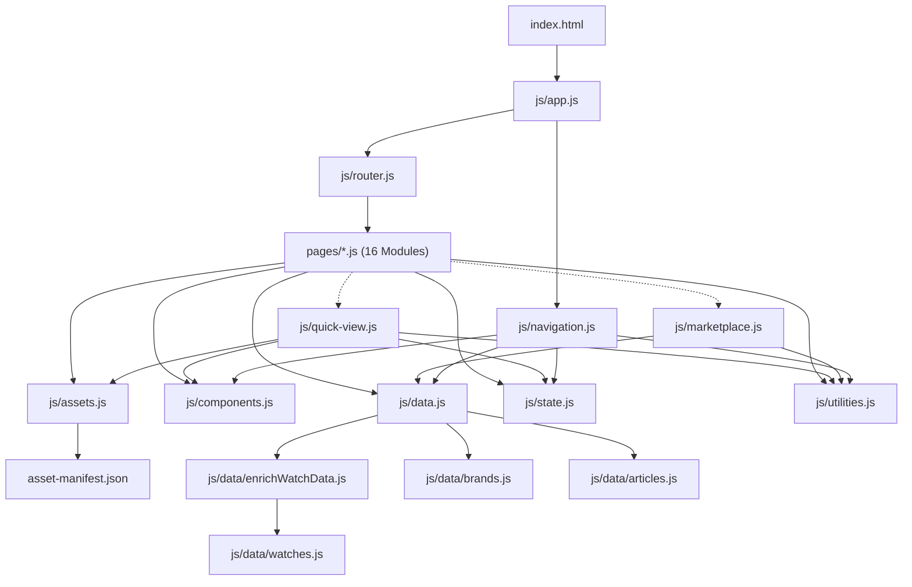

# HOROLOGY — System Architecture Specification

## 1. Executive Summary

HOROLOGY (*"Beyond Time. Beyond Ordinary."*) is a static, zero-build, modular Single-Page Application (SPA) engineered in semantic HTML5, CSS3, and Native Browser ES Modules. It delivers an observatory-grade digital marketplace for verified pre-owned luxury mechanical chronometers (Rolex, Omega, Tudor, and Grand Seiko) in **Direction C — Midnight Navy**.

---

## 2. Core Architectural Pillars

### A. Static Modular SPA (Zero-Build Pipeline)
- Modern browsers natively execute `<script type="module">` (`import` / `export`) with lexical scoping, strict mode, and zero external build tooling (no Webpack, Vite, Node, or npm).
- Persistent chrome (`index.html`) hosts the persistent site header, search overlay dialog, mobile navigation drawer, modal portal, and toast notification region. State and smooth route transitions are preserved across views without full DOM tree re-parsing.

### B. Client-Side Hash-Based Routing (`#/route`)
- **Subdirectory & Deep-Link Resilience:** GitHub Pages serves static files without server rewrite capabilities (`try_files` or `.htaccess`). Hash routing (`#/collection`, `#/watch/:slug`, `#/inspection/:watchId`) avoids HTTP 404 errors on browser page reloads or deep links in root and nested subpaths (`https://<user>.github.io/HOROLOGY/`).
- **Path Stability:** `window.location.pathname` never changes during hash navigation, guaranteeing that relative asset links (`./assets/...`) resolve identically across all 22 routes.

### C. Manifest-Driven Asset Resolution (`js/assets.js`)
- All imagery resolves through a centralized resolver function that verifies references against `asset-manifest.json` (67 audited Phase 01 physical assets).
- Graceful Degradation: If an asset is missing or corrupt, it falls back to an inline SVG horological dial illustration in Midnight Navy styling (`#07111F` / `#8DB8E8`).

### D. Centralized Reactive State Store (`js/state.js`)
- Lightweight pub/sub state container managing `wishlist`, `compareList`, `searchOpen`, `mobileMenuOpen`, `activeModal`, and `currentRoute`.
- Synchronizes with `localStorage` under namespaced keys (`horology_wishlist_v1`, `horology_compare_v1`) wrapped in `try/catch` guards for private browsing compatibility.
- Reactive subscribers update header counter badges in real time without triggering full-page renders.

### E. Marketplace Query & Filter Pipeline (`js/marketplace.js`)
- Ephemeral client-side query and facet filtering engine with debounced search.
- Pure multi-stage evaluation pipeline: `All Records -> Search Filter -> Facet Filter (8 dimensions) -> Sort (6 modes) -> Pagination Slice`.
- Live facet counting updates option badges dynamically according to available catalog items.
- Supports pre-seeded parameters for cross-route brand navigation (`#/collection?brand=...`).

### F. Encapsulated Modal Portal Architecture (`js/quick-view.js`)
- Renders directly into `#modalPortal` outside main layout flow.
- Features keyboard focus trapping (`Tab` / `Shift+Tab`), `Escape` key dismissal, aria accessibility attributes (`role="dialog"`, `aria-modal="true"`), and scroll lock on `document.body`.

### G. Canonical Watch Intelligence Data Model (`js/data/enrichWatchData.js`)
- Extends each of the 24 demonstration records with six deep, domain-authentic sub-objects:
  - `overview`: Headline, rich narrative description, design characteristics list, intended use, historical context, and lot significance.
  - `specifications`: Grouped dictionaries for Identity, Case Architecture, Dial & Handset, Movement Mechanics, Bracelet & Ergonomics, and Archival Accessories.
  - `movementIntelligence`: In-depth calibre breakdown, escapement mechanics, balance regulation, and complication matrix.
  - `conditionAssessment`: 5-tier internal rubric grades for 8 individual components, functional observations, and surface remarks.
  - `inspectionReport`: Forensic intake summary, 8-point authenticity review, documentation inventory, and strict honest telemetry.
  - `galleryItems`: Structured asset array of verified studio angles and placeholders for unphotographed physical macro angles.

### H. Multi-Resolution Flexible Watch Locator (`js/data.js`)
- `findWatchByIdentifier(identifier)` resolves watch requests matching either canonical `id` (e.g. `demo-rolex-126610ln`), `slug` (e.g. `rolex-submariner-date-126610ln`), or `referenceNumber` (e.g. `126610LN`), guaranteeing 0 broken links across versions.
- Canonical route `#/inspection/:watchId` is aliased with legacy route `#/dossier/:slug` to the exact same handler (`pages/dossier.js`).

### I. Printable Dossier Engine & Strict Telemetry Honesty (`pages/dossier.js`, `css/print.css`)
- Strict anti-fabrication layer: Demonstration records store `measuredValuesAvailable: false` with null telemetry fields. The UI transparently presents an authoritative "Timegrapher Telemetry Pending / Unavailable for Demonstration Record" notice alongside complete technical explanations of rate deviation, balance amplitude, and beat error tolerances.
- `@media print` rules format the dossier on white A4 paper with dark ink, hiding site navigation, buttons, and overlays.

---

## 3. Module Dependency Graph



---

## 4. Page Module Lifecycle Contract

Every page template module in `pages/` implements a standard functional contract:

```javascript
// Metadata
export const title = 'Page Title';

// Asynchronous HTML generator
export async function render(context) {
  // context = { path, params, query, route }
  return `<section class="container">...</section>`;
}

// Post-mount DOM binding & event delegation
export function mount(context) {
  // Bind listeners, timers, or observers
  return () => {
    // Optional teardown logic (unmount)
  };
}
```

---

## 5. Security & Accessibility Standards
- **Zero Third-Party Tracking / CDN Dependencies:** Self-contained static assets; Google Fonts load asynchronously with `font-display: swap`.
- **Keyboard Navigation & ARIA:** Strict `:focus-visible` outlines (`2px solid #8DB8E8`), focus-trapped dialogs and overlays (`trapFocus()`), semantic landmarks (`<header>`, `<nav>`, `<main>`, `<footer>`), and `aria-live="polite"` toast announcements.
- **Motion Restraint:** Full support for `@media (prefers-reduced-motion: reduce)` overriding animations and hover transformations.
