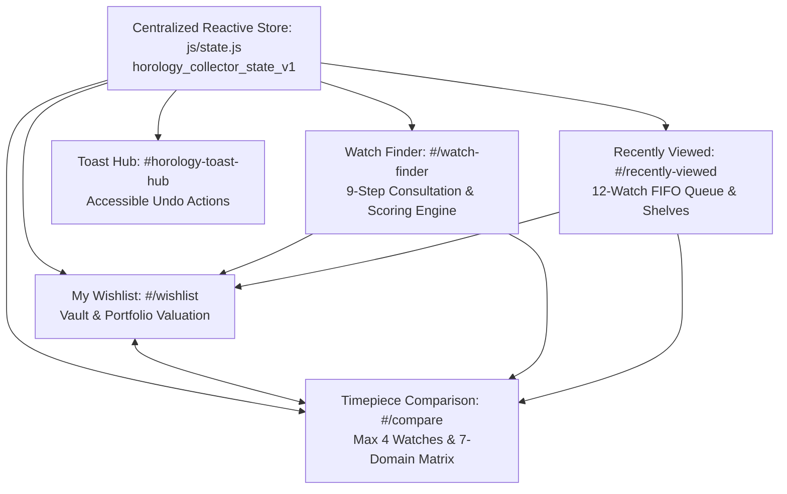

# HOROLOGY — Collector Tools Ecosystem Architecture
**Phase:** Phase 05 (Collector Tools)  
**Creative Direction:** Direction C — Midnight Navy (`#07111F` / `#8DB8E8` / `#263A50`)  
**Design Philosophy:** Transparent, Factual, Collector-Grade Private Observatory Tools

---

## 1. Executive Summary

Phase 05 of **HOROLOGY** (*"Beyond Time. Beyond Ordinary."*) expands the pre-owned luxury mechanical marketplace with five interconnected, client-side collector tools:
1. **My Wishlist** (`#/wishlist` — *"My Collection of Desires"*): A personal curatorial vault with valuation intelligence, batch actions, undo capability, and sharing mechanisms.
2. **Watch Comparison System** (`#/compare`): A side-by-side analytical matrix supporting up to four timepieces with sticky headers, seven horological domains, difference isolation, and factual synthesis.
3. **Recently Viewed Watches** (`#/recently-viewed` + Cross-Page Shelves): Persistent tracking with deduplication, dedicated chronological inspection history, and non-intrusive embedded shelves across the site.
4. **Intelligent Watch Finder** (`#/watch-finder` & `#/finder`): An eight-dimension consultation wizard backed by a transparent 100-point scoring algorithm, Step 9 review, relaxation diagnostic, and profile persistence.
5. **Persistent Collector Preferences & Unified State** (`js/state.js`): Single source of truth under `horology_collector_state_v1` with automatic migration from Phase 02–04 legacy storage keys, cross-tab synchronization, and floating undo notifications.

---

## 2. System Architecture & Interconnections

All five systems interact through the single reactive pub/sub state store (`js/state.js`). A watch added to the comparison list from the Wishlist instantly reflects in the global header badge counter, the Comparison Matrix route, and product cards across the marketplace.

---

## 3. Tool Suites Breakdown

### 3.1. My Wishlist ("My Collection of Desires")
- **Purpose:** Provide serious horological enthusiasts with a private, structured vault to collect, value, compare, and enquire about pre-owned references.
- **Key Capabilities:**
  - Automated portfolio valuation summary (Total Valuation, Average Value, Full Set Ratio).
  - Multi-select batch operations (Select All, Compare Selected 2–4, Remove Selected).
  - Accessible Undo toasts on single remove and Clear Vault operations.
  - Native Web Share API integration with automatic fallback to clipboard copy.
  - Embedded acquisition enquiry modal integration (`js/enquiry.js`).

### 3.2. Watch Comparison Matrix
- **Purpose:** Eliminate subjective salesmanship by juxtaposing 2 to 4 watches across rigorous physical, mechanical, and provenance dimensions.
- **Key Capabilities:**
  - Strict 4-watch ceiling (`MAX_COMPARE = 4`) with interactive 5th-watch replacement modal.
  - Sticky specification column on desktop and smooth horizontal touch-snap track on mobile.
  - Non-null difference highlighting toggle (filtering out `null`, `undefined`, and `Not specified` values).
  - 7 structured domains mapping 1:1 with Phase 04 watch data architecture.
  - Neutral, factual comparative insights (analyzing valuation spread, case diameter delta, power reserve autonomy, propulsion variety, and archival documentation).

### 3.3. Recently Viewed Watches
- **Purpose:** Enable frictionless browsing continuity during deep horological research.
- **Key Capabilities:**
  - 12-watch bounded FIFO history queue persisted in `localStorage`.
  - Rapid view reload deduplication preventing consecutive duplicate recordings of the same timepiece.
  - Dedicated chronological examination gallery (`#/recently-viewed`) with individual remove (`×`) and Clear History.
  - Reusable, lightweight horizontal shelf component (`createRecentlyViewedShelf()`) embedded across Watch Detail, Wishlist, Collection Marketplace, and Homepage.

### 3.4. Intelligent Watch Finder
- **Purpose:** Replicate the consultative experience of an elite private horological advisor through a structured question flow.
- **Key Capabilities:**
  - 8 consultative dimension questions + Step 9 Review screen with direct "Edit" jump triggers.
  - Progress bar and 9-pill direct jump navigation trail.
  - Transparent 100-point scoring algorithm (25/20/20/15/10/5/5 distribution).
  - Stratified results (Exact Matches $\ge 95\%$, Strong Matches $70\text{–}94\%$, Alternative Suggestions $50\text{–}69\%$).
  - Dynamic explanatory sentence generation per candidate card.
  - Consultative No-Match diagnostic screen with 1-click constraint relaxation buttons.

### 3.5. Unified State & Storage Engine
- **Purpose:** Ensure rock-solid persistence, data integrity, and cross-tab synchronization without requiring user accounts or backend infrastructure.
- **Key Capabilities:**
  - Unified storage namespace: `horology_collector_state_v1`.
  - Automatic migration reading legacy Phase 02–04 keys (`horology_wishlist_v1`, `horology_compare_v1`, etc.).
  - Validation against the 24 canonical demonstration watch IDs, automatically pruning corrupted or deprecated IDs.
  - Graceful in-memory fallback if `localStorage` throws quota errors or is disabled in private browsing modes.
  - Real-time multi-tab synchronization listening to browser `storage` events.

---

## 4. Design System Compliance

All collector tools strictly follow **Direction C — Midnight Navy**:
- **Backgrounds:** Primary Canvas (`#07111F`), Elevated Secondary (`#0D1B2A`), Card Slate (`#142538`).
- **Borders & Dividers:** Subtle Slate (`#263A50`), Highlighting Stroke (`rgba(141, 184, 232, 0.3)`).
- **Accents:** Ice Blue (`#8DB8E8`), Soft Cyan (`#64B5F6`), Gold/Emerald verification indicators.
- **Typography:** Cormorant Garamond for display headlines, Inter for functional UI controls, and JetBrains Mono for reference numbers, dimensions, and financial valuations.
- **Touch & Accessibility:** All interactive tap targets $\ge 44\text{px} \times 44\text{px}$, comprehensive ARIA attributes (`role="status"`, `role="toolbar"`, `aria-live="polite"`, `aria-pressed`), and keyboard focus rings.

