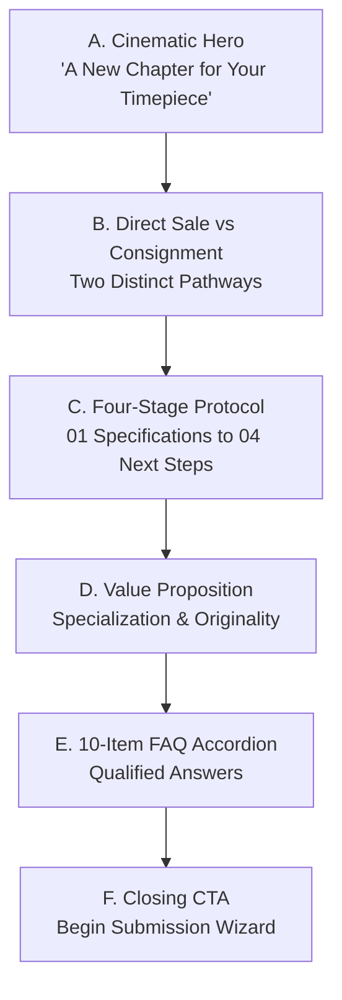

# HOROLOGY — Sell & Consign System Architecture
**Phase:** Phase 07 (Business & Responsive)  
**Routes:** `#/sell-consign` (Landing & Overview), `#/sell-consign/submit` (7-Step Wizard)  
**Aliases:** `#/consign`, `#/sell`, `#/consign/submit`, `#/sell/submit`  
**Controller:** `pages/consign.js`  
**Shared Form Engine:** `js/forms.js`  
**Stylesheets:** `css/business-forms.css`, `css/responsive.css`  
**Creative Direction:** Direction C — Midnight Navy (`#07111F` / `#8DB8E8` / `#263A50`)

---

## 1. Executive Overview

The Sell / Consign subsystem delivers an observatory-grade, private client intake experience for owners of luxury mechanical timepieces (specializing in **Rolex**, **Omega**, **Tudor**, and **Grand Seiko**). It balances curatorial discretion, transparent commercial discussion, and rigorous technical validation without making unsubstantiated guarantees (such as instant payouts, highest price promises, or automatic acceptance).

The architecture is partitioned into two distinct view modes managed dynamically by `pages/consign.js`:
1. **Editorial Overview Landing (`#/sell-consign`):** High-level educational and commercial exposition explaining the distinct mechanisms of direct sale versus consignment, a 4-stage engagement protocol, institutional values, and an interactive 10-item FAQ accordion.
2. **Multi-Step Submission Wizard (`#/sell-consign/submit`):** An accessible 7-step consultative form capturing timepiece reference identity, condition assessment, archival documentation, client-side photograph previews, contact coordinates, and an explicit confirmation review screen.

---

## 2. Landing Experience Structure (`#/sell-consign`)

### 2.1. Section Breakdown
- **Section A: Cinematic Hero:**
  - *Eyebrow:* `SELL OR CONSIGN`
  - *Headline:* Cormorant Garamond display headline: *"A New Chapter for Your Timepiece."*
  - *Prose:* Honest, calm invitation to start a preliminary conversation regarding timepiece acquisition or private curation.
  - *CTAs:* Primary *"Discuss Your Watch"* (`#/sell-consign/submit`), Secondary *"How It Works"* (smooth anchor scroll to `#how-it-works`).
- **Section B: Sell vs. Consign Pathways:**
  - *Option 01 — Direct Sale:* Outright purchase proposal following physical inspection and electronic timing verification. Suited for owners seeking immediate resolution and direct liquidity.
  - *Option 02 — Private Consignment:* Timepiece curated and presented across HOROLOGY’s private collector network on mutually agreed terms. Suited for maximizing realized value with an unhurried timeline.
  - *Strict Boundary:* Commission percentages, settlement schedules, and storage arrangements are established on an individual reference basis; no synthetic numbers are invented.
- **Section C: Four-Stage Engagement Process:**
  - `01 / SPECIFICATIONS` — Tell Us About Your Watch: Manufacturer, model, reference number, condition notes, and documentation.
  - `02 / INITIAL REVIEW` — Curatorial Review: Benchmark assessment of model suitability and platform alignment.
  - `03 / EVALUATION` — Discussion & Verification: Detailed photographs, physical inspection, timing machine telemetry, and commercial arrangements.
  - `04 / NEXT STEPS` — Mutual Agreement: Execution proceeds strictly upon written confirmation of agreed terms.
  - *Transparency Notice:* Submitting a request initiates a conversation and does not constitute a binding valuation or guarantee of acceptance.
- **Section D: Defensible Value Proposition:**
  - Specialised Curation (focus on the 4 canonical houses).
  - Respect for Originality (appreciation for untouched factory bevels, original chamfers, and unpolished cases).
  - Transparent Discussion (clear terms, no high-pressure salesmanship).
- **Section E: Expandable FAQ Accordion:**
  - 10 comprehensive questions covering acceptable brands, box/papers necessity, service documentation, evaluation protocol, shipping instructions, and commitment boundaries. Fully interactive with accessible ARIA state (`aria-expanded="true/false"`).

---

## 3. Multi-Step Submission Wizard (`#/sell-consign/submit`)

Operating as an unhurried, step-by-step consultative wizard:

| Step # | Domain | Form Controls & Capabilities | Validation & Constraints |
|:---:|---|---|---|
| **01** | **Selling Preference** | 4 Interactive Option Cards: Direct Sale, Consignment, Open to Both, Not Sure Yet. | Radio card selection with animated radio indicator dot. |
| **02** | **Watch Identity** | Manufacture select (Rolex, Omega, Tudor, Grand Seiko, Other), conditional custom text input when "Other" is chosen, Model name, Reference number, Approx. production year, Typology, Movement propulsion, Case metallurgy. | Required fields: Manufacturer, Model, Reference number. Conditional validation for custom brand text. |
| **03** | **Watch Condition** | 7 Indicative Condition Cards: Unworn, Excellent, Very Good, Good, Fair, Requires Assessment, Not Sure; Optional Condition Notes textarea. | Clearly states self-assessments are indicative and subject to physical verification. |
| **04** | **Included Items** | Multi-select check cards: Original Box, Original Papers, Warranty Card, Service Documentation, Purchase Receipt, Accessories, Extra Straps, Not Sure. | Multi-select state tracking; optional notes field for extra links or tags. |
| **05** | **Photographs** | Drag-and-drop file selector (`.photo-dropzone`), accepting JPG, PNG, WebP; client-side thumbnail gallery with remove controls (`×`). | Maximum 6 files; 10 MB per file limit. Explicit notice explaining local preview nature on static GitHub Pages. |
| **06** | **Contact Information** | Full Name, Email Address, Telephone (optional), Country (optional), Preferred Contact Channel (Email, Phone, WhatsApp), Message / Notes. | Required: Full Name, Email (RFC syntax check). Optional phone validated for international digit count ($\ge 7$ digits). |
| **07** | **Review & Confirmation** | Grouped summary table displaying all entered data; individual "Edit" jump triggers; explicit confirmation checkbox; primary *"Prepare My Enquiry"* CTA. | Button disabled until explicit confirmation checkbox is checked. |

---

## 4. Static-Site Submission Architecture

HOROLOGY is deployed statically without a cloud database. To maintain total integrity:
1. **Local File Handling:** Selected images are converted to local browser Object URLs (`URL.createObjectURL(file)`) for instantaneous UI previews. Large image binary blobs are **never** stored in `localStorage` or `sessionStorage`.
2. **Session Persistence:** Form answers are cached in `sessionStorage` (`horology_temp_sell_consign_v1`) to prevent data loss on accidental navigation, but are automatically expunged when the browser tab is closed. No client PII is stored permanently.
3. **Transmission Modal (`openTransmissionModal`):**
   - Clicking *"Prepare My Enquiry"* compiles a structured payload and opens the modal.
   - Formatted plain-text summary with a 1-click *"Copy to Clipboard"* button.
   - If an operator email is configured in `BUSINESS_CONFIG`, provides an automatic `mailto:` link pre-populating subject and body in the visitor’s email client.
   - Clear instructions explaining that photographic files selected locally should be attached directly to the outgoing email message.
   - **Zero False Deliveries:** The UI never displays a false "Enquiry delivered to server" confirmation.

