# HOROLOGY — Intelligent Watch Finder Architecture
**Routes:** `#/watch-finder` and `#/finder` (canonical alias)  
**Controller:** `pages/finder.js`  
**Recommendation Engine:** `js/watch-finder-engine.js`  
**Stylesheet:** `css/collector-tools.css`  
**Creative Direction:** Direction C — Midnight Navy

---

## 1. Architectural Overview

The HOROLOGY Intelligent Watch Finder simulates the bespoke, unhurried consultation of an experienced private horological advisor. Operating entirely client-side with zero external network dependencies, it leads prospective collectors through an 8-question guided inquiry, presents a comprehensive Step 9 Review screen, and scores the 24 demonstration references using a transparent, documented 100-point algorithm.

---

## 2. Nine-Step Consultative Experience

```mermaid
flowchart LR
    Hero[Entry Hero\nFind the Watch That Speaks to You] --> Q1[Step 1: Manufacture]
    Q1 --> Q2[Step 2: Investment Range]
    Q2 --> Q3[Step 3: Typology]
    Q3 --> Q4[Step 4: Propulsion]
    Q4 --> Q5[Step 5: Case Size]
    Q5 --> Q6[Step 6: Style Character]
    Q6 --> Q7[Step 7: Condition Grade]
    Q7 --> Q8[Step 8: Box & Papers]
    Q8 --> Step9[Step 9: Final Review Screen]
    Step9 --> Results[Scored Results Stratification]
```

### Consultative Step Definitions
1. **House of Manufacture (25 pts):** Rolex, Omega, Tudor, Grand Seiko, or *"Open to All Four Houses"*.
2. **Investment Range (Hard Constraint):** Flexible, Under ₹5 Lakh, ₹5–10 Lakh, ₹10–25 Lakh, or Above ₹25 Lakh (plus custom slider support).
3. **Horological Typology (20 pts):** Diver, Chronograph, Dress, GMT, Field, Sports, Everyday, or *"No Preference"*.
4. **Propulsion Philosophy (20 pts):** Automatic Self-Winding, Manual Winding, Spring Drive, High-Frequency Quartz, or *"No Preference"*.
5. **Case Proportions (15 pts):** Small ($\le 38\text{ mm}$), Medium ($39\text{–}41\text{ mm}$), Large ($\ge 42\text{ mm}$), or *"No Preference"*.
6. **Curatorial Aesthetic Character (5 pts):** Understated, Classic, Sporty, Bold, Minimalist, Technical, Vintage-inspired, or *"No Preference"*.
7. **Physical Condition Rating (10 pts):** Unworn, Excellent, Very Good, Good, or *"Any Verified Condition"*.
8. **Archival Box & Papers (5 pts / Hard Constraint):** *"Both Required (Strict Full Set)"*, *"Prefer Both"*, *"Not Essential"*, or *"No Preference"*.
9. **Final Review & Alignment Verification:** Comprehensive summary list of all selections with individual "Edit" jump triggers and a primary *"Discover My Watches"* execution button.

---

## 3. Transparent 100-Point Recommendation Algorithm

The scoring engine (`js/watch-finder-engine.js`) operates deterministically without machine-learning opacity or artificial commercial steering:

$$\text{Total Score} = S_{\text{brand}} + S_{\text{propulsion}} + S_{\text{typology}} + S_{\text{proportions}} + S_{\text{condition}} + S_{\text{archival}} + S_{\text{style}}$$

| Dimension | Points | Scoring Evaluation Rules |
|-----------|:------:|--------------------------|
| **Manufacturer** | **25** | Exact brand match receives 25 pts. If user selected *"Open to All"*, all brands receive full 25 pts. |
| **Movement Philosophy** | **20** | Exact movement type match receives 20 pts. *"No Preference"* awards full 20 pts. |
| **Typology & Complication** | **20** | Exact watch type match receives 20 pts. *"No Preference"* awards full 20 pts. |
| **Case Proportions** | **15** | Exact diameter bracket match receives 15 pts. Near-boundary tolerance ($\pm 1\text{ mm}$) awards 10 pts. *"No Preference"* awards 15 pts. |
| **Physical Condition** | **10** | Meets or exceeds preferred grade awards 10 pts. One tier below awards 5 pts. |
| **Archival Box & Papers** | **5** | Watch with full presentation set awards 5 pts. |
| **Curatorial Style Tag** | **5** | Explicit match against curated `styleTags` array awards 5 pts. |

### Strict Hard Constraints (Zero Points / Pruned)
- **Budget Exclusions:** If a specific budget bracket is chosen, watches priced outside that bracket are filtered out of exact match consideration.
- **Strict Full Set Requirement:** When *"Both Required (Strict Full Set)"* is selected, watches missing original boxes or guarantee papers are immediately eliminated.

---

## 4. Stratified Recommendation Output

Recommendations are ranked descending by match percentage and grouped into three clear tiers:
1. **Exact Matches ($\ge 95\%$ Alignment):** Green emerald verification badge. Fulfills all specified criteria and hard boundaries.
2. **Strong Matches ($70\%\text{–}94\%$ Alignment):** Ice blue accent badge. Fulfills core dimensions with minor variances in secondary criteria (e.g., dial colour or condition grade).
3. **Alternative Suggestions ($50\%\text{–}69\%$ Alignment):** Muted slate badge. Broadens the collector's horizon by introducing references from other prestigious manufactures that share similar mechanical or proportion profiles.

### Factual Match Explanation Sentences
Every recommendation card features a dynamically composed explanation sentence summarizing exact point alignments:
- *Example:* `"Matches your selected Geneva manufacture, Automatic chronometer movement, and 41 mm case proportions."`
- *Example:* `"Matches your Bienne manufacture, manual-wind chronograph preference, and complete collector box & papers."`

---

## 5. Consultative No-Match Screen & Constraint Relaxation

If the combination of strict budget and box/papers constraints eliminates all 24 demonstration watches:
- The engine computes diagnostic elimination totals (`eliminatedBy.budget`, `eliminatedBy.ownership`).
- The interface renders an informative consultation card explaining exactly why zero matches were found.
- **One-Click Relaxation Triggers:**
  - *"Relax Budget to Flexible"* (retains all aesthetic and mechanical preferences while unlocking all price tiers).
  - *"Relax Box & Papers Requirement"* (allows exceptional watch-only examples accompanied by the HOROLOGY Inspection Dossier).
  - *"Show Alternative Suggestions"* (relaxes strict constraints simultaneously to reveal the closest available candidates).
  - *"Edit Preferences"* (jumps directly back to the Step 9 Review screen).

---

## 6. Profile Persistence & Recall

- **Auto-Save:** Progress and completed answers are persistently serialized to `localStorage` under `horology_collector_state_v1.finderState`.
- **Resume Consultation:** If a collector returns to `#/watch-finder`, the entry hero detects the saved profile, displaying an active summary pill cluster with a *"Resume Consultation"* shortcut.
- **Manual Profile Save:** Collectors can click *"Save to Profile"* on the results screen to lock their horological profile for future visits.

